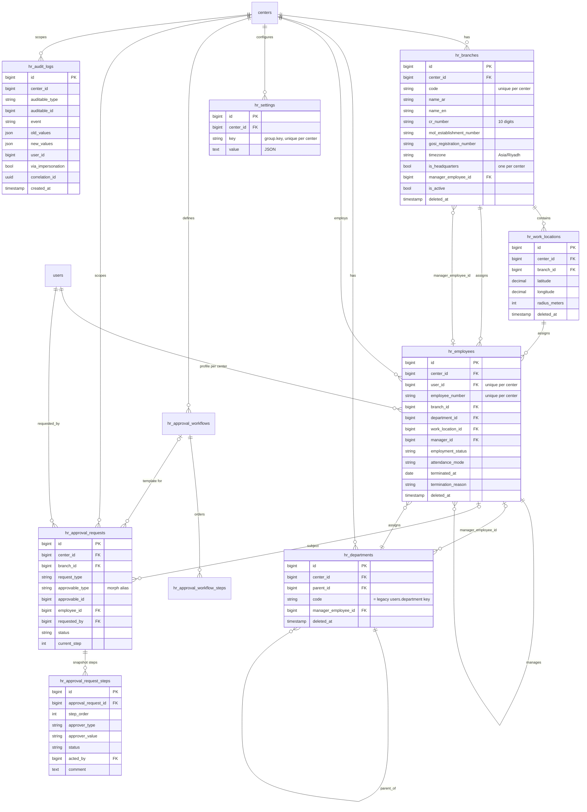
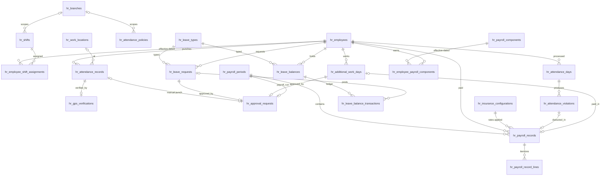

# Saudi HR Management Module — Architecture and Foundation

Status: **foundation implemented** (organization structure, employee HR profiles, settings, approval engine,
audit log, and their admin pages). Attendance, leave, additional work days and payroll are designed here
and are built on this foundation in later phases.

Contents

1. [Existing architecture analysis](#1-existing-architecture-analysis)
2. [Proposed HR architecture](#2-proposed-hr-architecture)
3. [Functional areas (16)](#3-functional-areas)
4. [Data model and ERD](#4-data-model-and-erd)
5. [Migrations plan](#5-migrations-plan)
6. [API endpoint plan](#6-api-endpoint-plan)
7. [Frontend page structure](#7-frontend-page-structure)
8. [Permissions](#8-permissions)
9. [Implementation dependencies](#9-implementation-dependencies)
10. [Integration risks](#10-integration-risks)
11. [Deployment and verification](#11-deployment-and-verification)

---

## 1. Existing architecture analysis

### 1.1 Stack

| Layer | Technology |
|---|---|
| Backend (`ecservice`) | Laravel 10.30, PHP 8.2, Sanctum 3 tokens, spatie/laravel-permission 5, mpdf, maatwebsite/excel, alkoumi/remls (Hijri dates) |
| Frontend (`ecsystem`) | Vue 3.2, Vite 4, Vuetify 3.2 (Vuexy 8 template), Pinia, vue-i18n 9, CASL 6, vite-plugin-pages (file routing), vite-plugin-vue-layouts |
| Database | MariaDB 10.4, InnoDB, `bigint unsigned` ids, `Schema::defaultStringLength(191)` |
| Time | `config('app.timezone') = Asia/Riyadh`; API serializes timestamps as ISO-8601 UTC |

### 1.2 Tenancy

- The tenant is the **center**. Users belong to centers through the `centers_users` pivot; one user can belong to
  several centers.
- Requests carry `center_id`. The backend accepts it when `$user->isInCenter`, otherwise falls back to the user's
  first center. The frontend adds `center_id` from `localStorage.center`, and the axios interceptor repairs a missing
  or zero value.
- There was **no branch concept** anywhere before this module.

### 1.3 Authentication and authorization

- Sanctum bearer tokens (`auth:sanctum, auth.relations` route group). Impersonation exists and is detectable.
- Permissions are spatie permissions named `{access|show|edit|admin|apply|add|delete|manage}_{module}` and are
  declared in `App\Support\PermissionCatalog::modules()`. `php artisan permissions:sync` creates missing permissions
  and grants them to the `admin` role.
- `module:` route middleware (`EnsureModulePermission`): GET needs access/show/edit/admin/apply, POST/PUT need
  edit/admin/apply, DELETE/PATCH need admin. Several modules in one middleware means "any of them".
- Frontend CASL abilities mirror permission names (`can('access_users', 'access_users')`); holding
  `admin_<module>` passes every check of that module. Route meta (`<route lang="yaml">`) declares
  `action`/`subject` or `actionsAny`.

### 1.4 API conventions

- `success($data, $meta, $message)` → `{ message, status: 'success', data }`.
- Paginated lists → `apiPaginateResponse`: `{ data, total, perPage, currentPage, lastPage, next, previous }`, driven
  by the Vuetify table `options` object (`options.page`, `options.itemsPerPage`, `options.sortBy`).
- Validation errors are Laravel 422 `{ message, errors: { field: [msg] } }`. The axios interceptor shows the first
  message per field in the global snackbar for every 422/403, so pages only handle success feedback.
- Translations: backend `lang/{ar,en}/tr.php` and `validation.php`; frontend `src/plugins/i18n/locales/{ar,en}.json`
  (Arabic default, RTL via `themeConfig.app.isRtl`).

### 1.5 Frontend conventions

- File-based routes; route name = path segments joined by `-` (`pages/hr/employees/list/index.vue` →
  `hr-employees-list`).
- Navigation template: `src/navigation/vertical/app-and-pages.js`. Breadcrumbs and back buttons are derived from it.
- Package gating removes nav items and blocks route-name substrings (e.g. `employees_attendance-` for packages 2/3).
- Lists use `VDataTableServer` + `watchServerTableFetch` / `applyServerTableOptions` (`@core/utils/tableFetch`).
- Form controls: `AppTextField`, `AppSelect`, `AppAutocomplete` (`server-search`, `preload`), `AppDateTimePicker`,
  `AppTextarea`. Page title/subtitle come from route meta `pageTitleKey`/`pageSubtitleKey` and header buttons
  from `PageHeaderActions`.
- Styles: logical CSS properties (`margin-inline`, `padding-block`), BEM, `@styles` alias.

### 1.6 Existing HR-related functionality (reused, not duplicated)

| Existing piece | What it holds | Decision |
|---|---|---|
| `users` table | Identity and contract data: `name`, `phone`, `id_or_residence_number`, `nationality`, `gender`, `birthdate`, `job_title`, `department` (string key), `work_shift`, `contract_type`, `hire_date`, `contract_end_date`, `id_expiry_date`, `annual_leave_entitlement` | **Stays the source of truth** for identity and contract fields. `hr_employees` only adds organizational assignment (branch, department, location, manager, status). |
| `User::departments()` / `tr.department.*` | Fixed list of department keys | `hr_departments.code` uses the same keys; `hr:sync-employees` creates them. |
| `employee_leaves` (user_id, type, dates, days, status) + `EmployeeLeaveController` | Simple leave with approve/reject and yearly balance | Kept running. Replaced in Phase 3 by `hr_leave_requests` with a backfill (see risks). |
| `employees_attendance` (user_id, attendance_at, status, from, to) + `EmployeeAttendanceController` | Daily manual attendance | Kept running. Superseded in Phase 2 by attendance records/days. |
| `employee_affairs` dashboard + `statisticsApi.fetchHrDashboard` | KPI cards from `users` and legacy tables | Kept; HR pages are added to the same nav group. |
| `logs` table | Generic activity log, no old/new values | Not reused for HR: HR needs field-level history → separate append-only `hr_audit_logs`. |
| `MediaAttachmentAuditLog::correlationIdFromRequest` | Request correlation id | Reused by `HrAuditLogger`. |
| Impersonation helpers | Detect admin acting as another user | Reused: audit rows store `via_impersonation`. |

---

## 2. Proposed HR architecture

### 2.1 Layers

```
routes/api.php  (prefix /api/hr, auth:sanctum + module:hr-* middleware)
   │
Http/Controllers/Hr/*      thin: resolve center, validate (FormRequest), call service, return Resource
Http/Requests/Hr/*         validation only (center-aware unique rules)
Http/Resources/Hr/*        stable JSON shapes for web and mobile
   │
Support/Hr/*               business logic, transactions, cross-record rules
   ├─ HrContext            center resolution (403 no_center)
   ├─ HrOrganizationService, HrEmployeeService, HrStaffSync
   ├─ HrSettings + HrSettingsRegistry   typed, validated, per-center settings
   ├─ Approvals/ApprovalService + ApprovalFlow (pure state machine) + Approvable interface
   ├─ HrAuditLogger        field-level diffs
   ├─ HrHierarchy          cycle detection (departments, managers)
   └─ HrException          domain error → 422 { errors, reason } localized from validation.hr.*
   │
Models/Hr/*                Eloquent, traits: BelongsToCenter, HasLocalizedName, Auditable
```

Rules applied everywhere:

- **Center isolation**: every HR table has `center_id`; every query goes through `forCenter()`; every referenced id
  (branch, department, manager, location) is re-checked against the center (`reference_not_in_center`).
- **Transactions**: every multi-row write (`saveBranch` headquarters switch, workflow step replacement,
  approval decisions with `lockForUpdate`, settings updates) runs in `DB::transaction`.
- **History**: organization records soft-delete and restore; approval steps are snapshotted when a request is
  submitted, so workflow edits never rewrite in-flight requests; `hr_audit_logs` is append-only (model refuses
  update/delete) and stores old/new values, actor, impersonation flag, IP, user agent, URL, correlation id.
  Values that change over time and affect money (shifts, compensation, GOSI rates) are **effective-dated rows**,
  not settings.
- **Bilingual data**: explicit `name_ar` (required) + `name_en` (optional); `name` accessor follows the request
  locale. Enum labels come from `tr.hr.*`; API returns both raw value and `*_label`.
- **Multi-branch**: `hr_branches` per center with CR / MHRSD / GOSI numbers and a timezone column; employees,
  work locations, approval requests (and later shifts, policies, payroll periods) carry `branch_id`.
- **Mobile-ready**: plain JSON resources, no session state, Sanctum tokens, one `GET /hr/lookups` call for all option
  lists, numeric ids, ISO dates. Self-service endpoints will live under `/api/hr/me/*` (Phase 2+).
- **Morph aliases** (`HrMorphMap`: `hr_branch`, `hr_employee`, `hr_approval_request`, …) keep polymorphic columns
  stable if classes move.

### 2.2 Approval engine (shared by every request type)

```php
// A business record (e.g. LeaveRequest) implements Approvable and submits itself:
class LeaveRequest extends Model implements Approvable
{
    public function approvalResolved(ApprovalRequest $request): void
    {
        // runs inside the approval transaction: update status, post balance ledger rows, ...
    }
}

$approval = ApprovalService::submit($leave, 'leave_request', $centerId, $user, $employee);
```

- Workflow per center and request type: ordered steps with approver types `direct_manager`,
  `department_manager`, `branch_manager`, `role` (role id), `user` (user id), `permission` (permission name).
- No active workflow → one step for holders of `apply_hr-approvals`.
- Requester and the subject employee can never approve their own request. Cancel: requester or
  `admin_hr-approvals`.
- Approvers do not need any HR permission (a direct manager can be a teacher), so authorization is checked in
  `ApprovalService::canAct`, not in route middleware.

---

## 3. Functional areas

Legend: ✅ implemented in the foundation · 🔜 designed, later phase.

| # | Area | Status | Design summary |
|---|---|---|---|
| 1 | Employee Management | ✅ (section 12) | `hr_employees` (one per user per center): employee number, branch, department, work location, manager, employment status, attendance configuration, employment start. Identity and contract stay on `users`. Employment periods, effective-dated salaries / insurance / shift assignments, private documents and an append-only change history. Later: Saudization (Nitaqat) flags derived from `nationality`. |
| 2 | Branches and Work Locations | ✅ | `hr_branches` (code, CR 10 digits, MHRSD establishment number, GOSI number, timezone, single headquarters per center, manager). `hr_work_locations` (branch, coordinates, radius; default radius from settings). Deleting a branch is blocked while employed staff remain. |
| 3 | Shift Management | ✅ definitions + assignments / 🔜 overrides | Implemented: `hr_shifts` (times, break, working days, optional branch scope) and effective-dated `hr_employee_shift_assignments`. Still planned: `hr_shifts` (times, crosses-midnight, break, working days, optional grace overrides, branch scope). `hr_employee_shift_assignments` effective-dated (`effective_from/to`), never updated in place. Legacy `users.work_shift` (morning/evening/both) mapped during backfill. Ramadan reduced hours (Article 98) via date-ranged shift overrides. |
| 4 | Attendance Configuration | ✅ settings, policies, per-employee configuration / 🔜 holidays | Implemented: `hr_attendance_policies` (grace periods, absence threshold, manual attendance flag) and per-employee method (electronic / manual / exempt), GPS verification policy, work location, grace override. Settings: grace minutes, default GPS radius, manual attendance allowed, weekend days. Phase 2: `hr_attendance_policies` (effective-dated, branch-scoped: GPS required, absence threshold, overtime cap) and `hr_holidays` (Eid al-Fitr, Eid al-Adha, Founding Day 22 Feb, National Day 23 Sep). |
| 5 | Electronic Attendance | 🔜 Phase 2 | `POST /api/hr/me/attendance` (check-in/out) writes immutable `hr_attendance_records` (source gps/device/import). Corrections are new rows plus a void flag, never edits. |
| 6 | GPS Location Monitoring | 🔜 Phase 2 | `hr_gps_verifications` per punch: coordinates, accuracy, computed distance, radius snapshot, within-radius result, mock-location flag, device info. Haversine distance in a pure service (unit-tested). |
| 7 | Manual Attendance | 🔜 Phase 2 | Manual punch = attendance record with `source=manual` that submits an approval request (`manual_attendance` type already exists in the engine). Gated by `attendance.allow_manual_attendance`. |
| 8 | Attendance Processing | 🔜 Phase 2 | Job builds `hr_attendance_days` (one row per employee per date): scheduled vs actual, worked/late/early/overtime minutes, status (present, absent, leave, holiday, weekend, off). Idempotent re-processing; days are locked once a payroll period is approved. Uses Friday/Saturday weekend setting and holidays. |
| 9 | Leave Management | 🔜 Phase 3 | `hr_leave_types` (system types per Saudi Labor Law: annual 21/30 days Art. 109, sick Art. 117, maternity Art. 151, Hajj Art. 114, marriage/bereavement/paternity Art. 113, exam Art. 115; plus custom), `hr_leave_balances` + balance ledger, `hr_leave_requests` (Approvable). Replaces legacy `employee_leaves` with backfill. |
| 10 | Absence and Late Management | 🔜 Phase 3 | Derived from attendance days into `hr_attendance_violations` (late, early leave, absence) with deduction amount, status (pending, confirmed, waived) and link to the payroll record that applied it. |
| 11 | Additional Working Days | 🔜 Phase 3 | `hr_additional_work_days` (date, minutes, compensation pay or time off, rate multiplier default 1.5 per Art. 107), approval type `additional_work_day` already exists. |
| 12 | Payroll Management | ✅ inputs only (salaries, insurance, eligibility) / 🔜 Phase 4 | Implemented as payroll inputs, no calculations: `hr_employee_salaries`, `hr_employee_insurances`, `hr_employment_periods`, `payroll.changes_locked_until`. Planned: `hr_payroll_components` (earning/deduction catalog, GOSI-subject flag), `hr_employee_payroll_components` (effective-dated amounts: basic, housing, transport), `hr_insurance_configurations` (effective-dated GOSI rates/caps by scheme), `hr_payroll_periods` (draft → processing → review → approved → paid → closed, approval type `payroll_run`), `hr_payroll_records` + `hr_payroll_record_lines` (fully snapshotted), `hr_employee_bank_accounts` (IBAN, for WPS/Mudad export). Currency SAR (setting). |
| 13 | HR Dashboard | 🔜 Phase 5 | Extends the existing `employee_affairs` dashboard: headcount by branch/department, Saudization ratio, today's attendance, pending approvals, expiring documents, payroll status. |
| 14 | Reports and Analytics | 🔜 Phase 5 | Exports via existing maatwebsite/excel and mpdf: attendance sheet, lateness, leave balances, payroll register, GOSI report, end-of-service provision. Hijri/Gregorian display per `general.calendar_display`. |
| 15 | HR Settings | ✅ | `hr_settings` key/value per center with typed registry (`HrSettingsRegistry`): validation rules, defaults (Saudi law minimums enforced, e.g. annual leave ≥ 21), casting, audit. UI is generated from the schema returned by the API. |
| 16 | Permissions, Approvals, Audit Logs | ✅ | Five permission modules (section 8), approval engine (2.2), audit log with old/new values and impersonation flag, UI pages for workflows, approvals inbox and audit log. |

---

## 4. Data model and ERD

### 4.1 Implemented tables



### 4.2 Planned tables (Phases 2–4)



Key planned columns:

| Table | Columns (beyond id, center_id, timestamps) |
|---|---|
| `hr_shifts` | branch_id?, code, name_ar, name_en, start_time, end_time, crosses_midnight, break_minutes, working_days (int list), late_grace_minutes?, early_leave_grace_minutes?, is_active, deleted_at |
| `hr_employee_shift_assignments` | employee_id, shift_id, effective_from, effective_to?, created_by — no overlap per employee (service-enforced, transactional) |
| `hr_attendance_policies` | branch_id?, name_ar, name_en, effective_from, effective_to?, require_gps, allow_manual, absence_after_minutes, max_daily_overtime_minutes |
| `hr_holidays` | date_from, date_to, name_ar, name_en, is_paid |
| `hr_attendance_records` | employee_id, branch_id, work_location_id?, type (check_in/check_out), occurred_at, source (gps/manual/device/import), recorded_by, approval_request_id?, voided_at?, voided_by?, void_reason?, notes |
| `hr_gps_verifications` | attendance_record_id, latitude, longitude, accuracy_meters, distance_meters, radius_meters_snapshot, within_radius, is_mock_location, device_info (json) |
| `hr_attendance_days` | employee_id, work_date (unique with employee), shift_id?, scheduled_start/end, first_in, last_out, worked/late/early_leave/overtime minutes, status, leave_request_id?, processed_at, payroll_period_id? (lock) |
| `hr_attendance_violations` | employee_id, attendance_day_id, type (late/early_leave/absence), minutes, deduction_amount, status (pending/confirmed/waived), waived_by?, payroll_record_id? |
| `hr_leave_types` | code, name_ar, name_en, is_system, is_paid, pay_percentage, deducts_balance, requires_attachment, max_days_per_request?, gender?, once_per_service (Hajj), carry_over_max_days, is_active |
| `hr_leave_balances` | employee_id, leave_type_id, year, entitled_days, carried_over_days, adjusted_days, used_days, pending_days (unique employee+type+year) |
| `hr_leave_balance_transactions` | leave_balance_id, delta_days, reason (accrual/request/adjustment/carry_over/expiry), leave_request_id?, created_by, created_at — append-only |
| `hr_leave_requests` | employee_id, leave_type_id, date_from, date_to, days, half_day?, reason, attachment (media), status, approval_request_id?, created_by |
| `hr_additional_work_days` | employee_id, work_date, minutes, compensation (pay/time_off), rate_multiplier (1.50), reason, status, approval_request_id?, payroll_record_id? |
| `hr_payroll_components` | code, name_ar, name_en, kind (earning/deduction), calculation (fixed/percent_of_basic), is_gosi_subject, is_system, is_active |
| `hr_employee_payroll_components` | employee_id, component_id, amount?, percentage?, effective_from, effective_to? |
| `hr_insurance_configurations` | center_id? (null = national default), scheme (gosi_saudi/gosi_non_saudi/…), employee_rate, employer_rate, hazards_rate, saned_employee_rate, saned_employer_rate, wage_floor, wage_cap, effective_from, effective_to? — **rates entered and confirmed by the client's payroll officer**; never hard-coded |
| `hr_payroll_periods` | branch_id?, period_start, period_end, status, approval_request_id?, processed_at, locked_at |
| `hr_payroll_records` | payroll_period_id, employee_id (unique per period), snapshots: branch_id, department_id, nationality, iban, basic, gross, total_deductions, gosi_employee, gosi_employer, net, worked_days, absence_days |
| `hr_payroll_record_lines` | payroll_record_id, component_id?, code, name_ar, name_en, kind, quantity, amount, source (component/overtime/absence/late/leave/additional_day/adjustment), source_id? |
| `hr_employee_bank_accounts` | employee_id, bank_name, iban (SA + 22), effective_from, effective_to? |

---

## 5. Migrations plan

All HR migrations are additive (new `hr_*` tables only), guarded with `Schema::hasTable`, and reversible.

| Phase | Migration | Tables | Status |
|---|---|---|---|
| 1 | `2026_11_05_100000_create_hr_organization_tables` | hr_branches, hr_work_locations, hr_departments | ✅ |
| 1 | `2026_11_05_100100_create_hr_employees_table` | hr_employees (+ manager_employee_id on branches/departments) | ✅ |
| 1 | `2026_11_05_100200_create_hr_settings_table` | hr_settings | ✅ |
| 1 | `2026_11_05_100300_create_hr_approval_tables` | hr_approval_workflows, hr_approval_workflow_steps, hr_approval_requests, hr_approval_request_steps | ✅ |
| 1 | `2026_11_05_100400_create_hr_audit_logs_table` | hr_audit_logs | ✅ |
| EM | `2026_11_05_130000_create_hr_attendance_setup_tables` | hr_shifts, hr_attendance_policies | ✅ |
| EM | `2026_11_05_130100_extend_hr_employees_for_employee_management` | hr_employees: employment_start_date, contract_start_date, gps_policy, grace_minutes, attendance_policy_id; attendance mode `gps` → `electronic` + gps_policy `required` | ✅ |
| EM | `2026_11_05_130200_create_hr_employee_records_tables` | hr_employment_periods (backfilled), hr_employee_salaries, hr_employee_insurances, hr_employee_shift_assignments, hr_employee_documents, hr_employee_changes | ✅ |
| 2 | create_hr_holidays_table | hr_holidays | 🔜 |
| 2 | create_hr_attendance_tables | hr_attendance_records, hr_gps_verifications, hr_attendance_days | 🔜 |
| 3 | create_hr_leave_tables | hr_leave_types (+ system type seeder), hr_leave_balances, hr_leave_balance_transactions, hr_leave_requests | 🔜 |
| 3 | create_hr_absence_and_overtime_tables | hr_attendance_violations, hr_additional_work_days | 🔜 |
| 3 | backfill command `hr:import-legacy-leaves` | employee_leaves → hr_leave_requests / balances (dry-run default) | 🔜 |
| 4 | create_hr_payroll_tables | hr_payroll_components, hr_employee_payroll_components, hr_insurance_configurations, hr_payroll_periods, hr_payroll_records, hr_payroll_record_lines, hr_employee_bank_accounts | 🔜 |

Data backfill already available: `php artisan hr:sync-employees [--center=ID] [--apply]` creates departments from the
legacy `users.department` keys and an HR profile for every staff user of each center (dry-run unless `--apply`).

---

## 6. API endpoint plan

All under `/api/hr`, `auth:sanctum`, `center_id` query/body parameter. Lists accept `options[page]`,
`options[itemsPerPage]`, `options[sortBy][0][key|order]`, and return the paginated shape.

### 6.1 Implemented (68 routes)

| Method | Path | Permission | Notes |
|---|---|---|---|
| GET | `/lookups` | any `hr-*` module | branches, departments, work_locations (with branch_id), employment_statuses, attendance_modes, termination_reasons, request_types, approval_statuses, approver_types, auditable_types, approver_roles, approver_permissions |
| GET/POST | `/branches` | hr-organization | filters `q`, `is_active`, `trashed` |
| GET/PUT/DELETE | `/branches/{id}` | hr-organization (DELETE: admin) | delete blocked while employed staff remain; cascades work locations |
| PATCH | `/branches/{id}/restore` | admin_hr-organization | |
| GET/POST, GET/PUT/DELETE, PATCH restore | `/work-locations…` | hr-organization | filter `branch_id`; default radius from settings |
| GET/POST, GET/PUT/DELETE, PATCH restore | `/departments…` | hr-organization | cycle-safe parent; delete blocked with employees/children |
| GET | `/employees` | hr-employees | filters `q` (name, number, ID/Iqama), `branch_id`, `department_id`, `employment_status`, `job_title`, `attendance_mode`, `manager_id`, `employed_only`, `ids[]` |
| GET | `/employees/candidates` · `/employees/job-titles` | hr-employees | staff users without a profile; job titles in use |
| POST | `/employees` | edit_hr-employees | `mode=existing` (`user_id`) or `mode=new` (creates a staff user, login disabled); opens the first employment period |
| GET/PUT | `/employees/{id}` | hr-employees | PUT cannot terminate (use deactivate); `effective_date` + `change_reason` go to the history |
| PUT | `/employees/{id}/attendance` | edit_hr-employees | method, GPS policy, work location, policy, grace |
| POST | `/employees/{id}/photo` · `/photo/remove` | edit_hr-employees | image ≤ 5 MB |
| PATCH | `/employees/{id}/deactivate` · `/activate` | admin_hr-employees | closes / opens an employment period |
| GET | `/employees/{id}/history` | hr-employees | financial types hidden without hr-compensation |
| GET/POST, POST `{row}/cancel` | `/employees/{id}/shifts` | hr-employees | effective-dated assignments |
| GET/POST, POST `{row}/cancel` | `/employees/{id}/salaries` · `/insurances` | hr-compensation | effective-dated, immutable |
| GET | `/employees/payroll-eligibility` | hr-compensation | `period_start`, `period_end` → employees with overlapping employment days |
| GET/POST, PUT/DELETE, GET download | `/employees/{id}/documents…` | hr-documents (DELETE: admin) | private disk, streamed through the API |
| CRUD + PATCH restore | `/shifts…` · `/attendance-policies…` | hr-attendance-setup | delete blocked while assigned to employed staff |
| GET/PUT | `/settings` | hr-settings | returns `{ values, schema }`; PUT body `{ settings: { group: { key: value } } }` |
| GET/PUT | `/approval-workflows` | access/edit_hr-approvals | PUT upserts by `request_type` and replaces steps |
| GET | `/approvals` | signed-in user | `scope=awaiting_me` (default) / `mine` / `all` (access_hr-approvals), `status`, `request_type` |
| GET | `/approvals/{id}` | requester, subject, approver, or access_hr-approvals | includes `can_act`, `can_cancel`, steps with labels |
| POST | `/approvals/{id}/approve` · `/reject` · `/cancel` | decided by `ApprovalService` | optional `comment` |
| GET | `/audit-logs` | access_hr-audit | filters `auditable_type`, `auditable_id`, `event`, `user_id`, `date_from`, `date_to` |

### 6.2 Planned

| Phase | Endpoints |
|---|---|
| 2 | `/shifts` CRUD, `/employees/{id}/shift-assignments` (GET, POST new effective row), `/attendance-policies` CRUD, `/holidays` CRUD, `/attendance/records` (GET, POST manual punch → approval), `/attendance/days` (GET, POST `/process` for a date range), `/attendance/records/{id}/void` |
| 3 | `/leave-types` CRUD, `/leave-requests` (CRUD + submit), `/leave-balances` (GET, POST adjustment), `/violations` (GET, POST waive), `/additional-work-days` CRUD + submit |
| 4 | `/payroll-components` CRUD, `/employees/{id}/compensation` (effective-dated), `/insurance-configurations` CRUD, `/payroll-periods` (CRUD, `/process`, `/submit`, `/records`, `/export/wps`) |
| 5 | `/dashboard`, `/reports/{report}` (JSON + `?format=xlsx|pdf`) |
| Mobile (2+) | `/me` (profile), `/me/shift`, `POST /me/attendance` (check-in/out with GPS payload), `/me/attendance`, `/me/leave-balances`, `/me/leave-requests`, `/me/approvals` (same engine) — resolved from the token user, no `employee_id` parameter |

---

## 7. Frontend page structure

Implemented (`ecsystem/src`):

```
plugins/apis/hrRequest.js            API client (center_id added automatically)
composables/useHrLookups.js          shared, cached option lists (reset on account switch)
composables/useHrCrudTable.js        server table + dialog + delete/restore for HR resources
components/hr/HrConfirmDialog.vue
utils/hrFormat.js                    Riyadh-time date formatting, status colors
styles/hr-module.scss                logical properties only (RTL/LTR)
pages/hr/
  organization/index.vue             tabs: branches · departments · work locations   (access_hr-organization)
  employees/list/index.vue           employee list: search, sort, filters, activate/deactivate (access_hr-employees)
  employees/add/index.vue            registration form (existing staff member or new)  (edit_hr-employees)
  employees/edit/[id].vue            personal + employment edit with effective date   (edit_hr-employees)
  employees/view/[id].vue            profile: bio card + tabs personal · employment · financial ·
                                     attendance · documents · history                 (access_hr-employees)
  attendance-setup/index.vue         tabs: shifts · attendance policies               (access_hr-attendance-setup)
  approvals/list/index.vue           inbox: awaiting me · my requests · all          (any signed-in user)
  settings/index.vue                 tabs: HR settings (schema-driven) · approval workflows
  audit-logs/list/index.vue          audit log with expandable old/new diff         (access_hr-audit)
views/hr/{organization,employees,employees/profile,attendance,settings,approvals,audit}/*.vue
composables/useHrEmployeeRecords.js  effective-dated rows: list, add, cancel scheduled
utils/saudiId.js                     client-side National ID / Iqama checksum (mirrors SaudiIdentity)
```

Navigation: items added to the existing **Employee affairs** group (`employee_affairs`), each gated by its
permission; the group appears for users holding only HR permissions.

Planned pages:

| Phase | Pages |
|---|---|
| 2 | `hr/shifts`, `hr/attendance/records`, `hr/attendance/daily`, `hr/attendance/policies`, `hr/holidays`; employee profile tab "Shifts" |
| 3 | `hr/leave/requests`, `hr/leave/balances`, `hr/leave/types`, `hr/violations`, `hr/additional-work-days` |
| 4 | `hr/payroll/periods`, `hr/payroll/periods/[id]`, `hr/payroll/components`, `hr/payroll/insurance` |
| 5 | `hr/dashboard` (or extend `employee_affairs`), `hr/reports/[report]` |
| Self-service | "My requests" entry visible to all staff once leave/attendance requests exist |

---

## 8. Permissions

Implemented (in `PermissionCatalog`, synced with `php artisan permissions:sync`):

| Module | Permissions |
|---|---|
| hr-organization | access, edit, admin (delete/restore) |
| hr-employees | access, edit, admin (activate / deactivate) |
| hr-compensation | access (see salaries, insurance, financial history), edit |
| hr-documents | access, edit (upload / edit details), admin (delete) |
| hr-attendance-setup | access, edit, admin (delete/restore shifts and policies) |
| hr-settings | access, edit |
| hr-approvals | access (see all requests), apply (default approver), edit (configure workflows), admin (cancel any) |
| hr-audit | access |

Planned: `hr-attendance` (access, edit, apply manual punches, admin void),
`hr-leave` (access, edit, admin adjust balances), `hr-payroll` (access, edit, admin), `hr-reports` (access).
Self-service actions are authorized by "the token user is the employee", not by a permission.

---

## 9. Implementation dependencies

```
Phase 1 foundation (done)
  ├─ organization (branches, departments, locations) ─┐
  ├─ employee profiles ───────────────────────────────┤
  ├─ settings ────────────────────────────────────────┤
  ├─ approval engine ─────────────────────────────────┤
  └─ audit log ───────────────────────────────────────┘
        │
Phase 2 shifts → attendance policies/holidays → attendance records + GPS → daily processing
        │                                                     │
Phase 3 leave types/balances/requests ──────────────► processing marks leave days
        violations (needs daily processing) · additional work days
        │
Phase 4 compensation + GOSI configs → payroll periods → records/lines (consume days, violations,
        additional days, unpaid leave) → WPS export
        │
Phase 5 dashboard + reports (read models over all of the above)
```

Operational prerequisites before Phase 2 goes live: run `hr:sync-employees --apply` per center, create branches and
work locations with coordinates, assign HR permissions to the relevant roles.

---

## 10. Integration risks

| Risk | Impact | Mitigation |
|---|---|---|
| Legacy `employee_leaves` / `employees_attendance` are user-based (no `center_id`) and their routes have **no permission middleware** (auth only) | Multi-center users share one leave history; any signed-in user can call them | Untouched in this task (unrelated module). Phase 2/3 replace them with center-scoped tables + backfill; add `module:` middleware when migrating. |
| `users.annual_leave_entitlement`, `users.department`, `users.work_shift` overlap with HR data | Two sources of truth | Precedence: per-user entitlement override > HR setting; `hr_departments.code` = legacy keys; work_shift mapped to shifts during Phase 2 backfill. Later make the legacy fields read-only mirrors. |
| Existing HR dashboard (`fetchHrDashboard`) reads legacy tables | Numbers diverge once HR tables are used | Switch dashboard queries in Phase 5 behind the same endpoint. |
| Package gating works by route-name substring and nav filtering | HR pages currently visible for every package | Product decision needed: which packages include HR; then add `hr-` to the gating list. |
| A user can belong to several centers | One employee per center, separate payroll per center | Enforced by unique (center_id, user_id). |
| Approval workflows are per center and request type, not per branch | Branches cannot have different chains yet | Add nullable `branch_id` to `hr_approval_workflows` with branch-first lookup when needed. |
| `awaiting_me` scans at most 500 pending requests per call | Very large backlogs could hide items | Acceptable for current scale; replace with an indexed approver projection table if volume grows. |
| Unique codes include soft-deleted rows | Re-creating a deleted branch code fails | Restore the deleted record instead (UI exposes "show deleted" + restore). |
| `/hr/lookups` requires an HR permission | Managers without HR permissions cannot load option lists | The approvals inbox does not depend on lookups. |
| Approvals route is open to any signed-in user (managers approve without permissions) | Parents can open the page | Backend only returns requests they submitted / can act on; the nav item is shown only to HR approvers. |
| New permissions are granted only to the `admin` role on sync | Center managers do not see HR pages until roles are updated | Assign in Roles & Permissions after deployment. |
| `hr_audit_logs` grows unbounded; append-only enforced at model level | Storage; raw SQL could still alter rows | Add retention/archival job; optionally DB-level grants/trigger. |
| Hijri display setting exists, formatting is Gregorian today | Calendar preference not yet honored | Use existing `AppHijriDate` / alkoumi hijri helpers in Phase 5 reports. |
| GOSI rates and caps change over time | Wrong payroll if hard-coded | Effective-dated `hr_insurance_configurations`, values entered/confirmed by the client. |
| `paginationMeta` text is hardcoded in English (existing) | Mixed-language footer in Arabic UI | Out of scope; tracked. |

---

## 11. Deployment and verification

```bash
# backend
php artisan migrate                      # creates the hr_* tables (additive only)
php artisan permissions:sync             # registers hr-* permissions, grants them to admin
php artisan hr:sync-employees            # dry run: shows departments/profiles that would be created
php artisan hr:sync-employees --apply    # writes them (optionally --center=ID)

# tests
php artisan test tests/Feature/Hr tests/Unit/HrApprovalFlowTest.php tests/Unit/HrHierarchyTest.php \
                 tests/Unit/HrAuditDiffTest.php tests/Unit/HrSettingsRegistryTest.php tests/Unit/HrEmployeeRulesTest.php

# frontend
npm run build
```

Feature tests run on in-memory SQLite (`tests/Feature/Hr/HrTestCase.php` builds the minimal shared schema and runs the
real HR migrations), covering center isolation, permission enforcement, headquarters uniqueness, cycle prevention,
employee numbering, settings validation/audit, approval chains, self-approval prevention, fallback approver, and
step snapshotting. `HrEmployeeManagementApiTest` covers registration validation, list filters, change logging,
effective dating and the payroll lock, compensation visibility, insurance categories, deactivation / reactivation
and payroll eligibility, shifts and policies, documents and photo validation. `HrBranchLocationApiTest` covers
branch validation and status changes, in-use guards, branch / location employee lists, the map endpoint,
effective-dated transfers (scheduled, back-dated, same-day correction, cancel, `applyDue`) and branch-manager scope.

---

## 12. Employee Management

### 12.1 Where data lives

| Data | Table | Why |
|---|---|---|
| Name, photo, nationality, gender, birthdate, phone, email, National ID / Iqama (+ expiry), national address, job title, hiring date, contract type / end | `users` | Already edited by the staff module; HR writes the same columns instead of copying them |
| Employee number, branch, department, manager, status, employment start, contract start, attendance configuration | `hr_employees` | Per center |
| Employment periods | `hr_employment_periods` | Drive payroll eligibility (one open period at most) |
| Basic salary + housing / transportation / other allowances | `hr_employee_salaries` | Effective-dated, immutable |
| Insurance category (saudi / non_saudi / gcc / exempt), employee and employer rates, contribution start | `hr_employee_insurances` | Effective-dated, immutable; category must match nationality |
| Assigned shift | `hr_employee_shift_assignments` | Effective-dated, immutable |
| Documents, contracts, attachments | `hr_employee_documents` | Files on the private `local` disk (`hr/center_{id}/employees/{id}/`), downloaded through the API |
| History (salary, allowances, branch, shift, attendance method, insurance, status…) | `hr_employee_changes` | Append-only; old/new value plus a bilingual label snapshot |

### 12.2 Business rules

- **Employee number** unique per center (DB unique index + request validation).
- **National ID / Iqama**: 10 digits, Luhn-style checksum, prefix 1 for Saudi nationals and 2 for residents
  (nationality-aware), Arabic-Indic digits normalized, unique across all users (one person = one user, even in
  several centers). Minimum age 15 (Labor Law Article 162).
- **Salary values**: numeric, two decimals, basic > 0, allowances ≥ 0; gross = sum computed in halalas.
- **Effective dating**: a new salary / insurance / shift row must start after the latest row; the previous row is
  closed the day before. Rows are never updated. Only the latest *scheduled* (future) row can be cancelled; the
  cancellation is itself logged.
- **Payroll lock**: setting `payroll.changes_locked_until`; no effective date (changes, deactivation, activation)
  may fall on or before it, so closed payroll periods are never affected by later edits.
- **Deactivation** closes the open employment period on the end date (scheduled changes after that date must be
  cancelled first). **Activation** opens a new period after the last end date. `GET /employees/payroll-eligibility`
  and `Employee::scopeEligibleForPayrollPeriod()` return employees whose periods overlap the payroll period, so a
  deactivated employee still appears in the period that contains their last working days and in no later one.
- **Visibility**: salaries, insurance and financial history require `hr-compensation`; documents require
  `hr-documents`.

### 12.3 Not in scope (by request)

Payroll calculations, GOSI contribution amounts, attendance punches and attendance processing. Shifts, policies and
GPS settings are stored and assigned only.

---

## 13. Branches and work locations

### 13.1 Data

| Data | Table | Notes |
|---|---|---|
| Branch: code, names, address, city, country (ISO-2, default `SA`), phone, email, manager, CR / MOL / GOSI numbers, HQ flag, status | `hr_branches` | `country` and `email` added by `2026_11_05_140000_create_hr_employee_work_assignments_table` |
| Work location: branch, names, address, latitude, longitude, GPS radius (10–5000 m, empty = `attendance.default_gps_radius_meters`), status | `hr_work_locations` | One branch has many locations |
| Where an employee works: branch + optional work location from `effective_from` | `hr_employee_work_assignments` | Effective-dated, immutable (same rules as salaries); backfilled with one row per employee from the employment start |

`hr_employees.branch_id` / `work_location_id` mirror the assignment **in force today**. They are what lists, filters
and branch scoping read. Rows dated today or earlier update them immediately; future rows are applied by
`hr:apply-work-assignments` (scheduled daily at 00:05 Asia/Riyadh).

### 13.2 Rules

- A branch transfer or location change is a new row (`POST /hr/employees/{id}/work-assignments`, reason required).
  The previous row closes the day before, so earlier periods keep the branch/location in force at the time, and both
  changes are written to the employee timeline. A change on the same date as the latest row corrects that row
  (subject to the payroll lock). Only the latest scheduled row can be cancelled.
- Editing the branch in the employee form, or the work location in the attendance tab, goes through the same
  service (effective date = the form's effective date).
- The branch must be active; the location must be active and belong to the branch; employees with GPS required need
  a location with coordinates.
- **GPS attendance** must call `Employee::effectiveWorkLocation($date)`: the location of the assignment in force on
  the attendance day (the cached column is used only for legacy profiles without any assignment row).
- Branches and locations are activated / deactivated through `PATCH …/activate|deactivate` (admin permission);
  `is_active` is ignored on update. Deactivating or deleting is refused while employed staff are assigned, or
  scheduled to move there. A location can only be activated under an active branch, and cannot move to another
  branch while employees are assigned.

### 13.3 Branch scope

Permission `access_hr-all-branches` (module `hr-all-branches`) gives the whole center. Without it, HR permissions
are narrowed to the branches whose `manager_employee_id` is the user's own employed profile:

- branches, work locations, employees, shifts (plus center-wide shifts) and lookups are filtered; records of other
  branches answer 404;
- writes that target another branch answer 403 `branch_not_authorized`;
- creating branches, assigning managers, the HQ flag, activating / deactivating / deleting branches and center-wide
  shifts need the permission (403 `branch_scope_required`).

`permissions:sync` grants the new permission once (when it is created) to roles that already hold
`admin_hr-organization` or `admin_hr-employees`, so existing HR administrators keep center-wide access. Approvals and
audit logs are not branch-scoped.

### 13.4 Endpoints

| Method | Path |
|---|---|
| GET | `/hr/branches` (filters `q`, `is_active`, `city`, `country`, `has_manager`), `/hr/branches/cities`, `/hr/branches/{id}`, `/hr/branches/{id}/employees` |
| PATCH | `/hr/branches/{id}/activate`, `/hr/branches/{id}/deactivate` |
| GET | `/hr/work-locations` (filters `q`, `branch_id`, `is_active`, `has_coordinates`), `/hr/work-locations/map`, `/hr/work-locations/{id}/employees` |
| PATCH | `/hr/work-locations/{id}/activate`, `/hr/work-locations/{id}/deactivate` |
| GET / POST | `/hr/employees/{id}/work-assignments`, `POST /hr/employees/{id}/work-assignments/{row}/cancel` |

### 13.5 Frontend

- `components/hr/HrLocationMap.vue`: Leaflet + OpenStreetMap tiles (no API key). Picker mode (click or drag the pin,
  "use my location", geofence circle following the radius) and viewer mode (several locations with their circles,
  popups, fit to bounds).
- Organization page: branches table (filters, manager, status actions, link to the branch page) and work locations
  table (list / map toggle, map picker in the dialog, assigned employees dialog, status actions).
- `pages/hr/organization/branches/[id].vue`: branch information, map of its locations, assigned employees, locations.
- Employee profile → Employment tab: assignment history, transfer dialog (future dates schedule the transfer), cancel
  the scheduled transfer. The employee list gained a work location filter.

### 13.6 Deployment

```bash
php artisan migrate                  # hr_employee_work_assignments + branch country/email, with backfill
php artisan permissions:sync         # creates access_hr-all-branches and grants it to HR admin roles
# cron must run `php artisan schedule:run` every minute for hr:apply-work-assignments
npm install                          # adds leaflet (package-lock.json updated; yarn.lock is not)
```

GPS tracking and attendance punches are not part of this phase.

## 14. Shift management

### 14.1 Data

| Data | Table | Notes |
|---|---|---|
| Shift: code, names, type (`morning`, `evening`, `night`, `rotating`, `custom`), colour, branch (empty = all branches), status | `hr_shifts` | Also caches the timing of the version in force today (`current_version_id`) |
| Timing version: start / end, break minutes, optional fixed break start, expected minutes, late and early-leave grace, working days, weekly rest days, rotation pattern | `hr_shift_versions` | Effective-dated (`effective_from` / `effective_to`, unique per shift and date) |
| Employee shift assignment, plus employee-specific schedule: rotation start day (`rotation_offset`), own working / rest days | `hr_employee_shift_assignments` | Effective-dated, immutable (same rules as salaries) |
| Branch default shift for new hires | `hr_branches.default_shift_id` | Fixed shifts only |
| Exception / temporary change for an employee, a branch or the whole center over a date range: day off, a different shift, or custom hours | `hr_shift_exceptions` | Soft-deleted when cancelled |

Migration `2026_11_05_150000_extend_hr_shifts_for_shift_management` is additive. It backfills the type (from the
start time), rest days (complement of the working days) and one timing version per existing shift, starting at its
first assignment.

No time or grace value is hardcoded: times come from the shift version, and empty grace values fall back to the
attendance policy, then to the HR settings.

### 14.2 Rules

- **Overnight**: an end time at or before the start time ends on the next calendar day. The whole shift belongs to the
  day it starts on, and equal start and end times mean a 24-hour shift.
- **Rotating** shifts are a cycle of 1 to 56 days. Each day is a fixed shift or a rest day, with at least one rest day
  per 7 days. The cycle day on a date is `(rotation_offset + days since the assignment started) mod cycle length`.
  Slot shifts must be active, fixed and allowed in the branch.
- **Effective-dated changes**: identity fields (code, names, colour, branch) are edited in place. Timing changes on a
  shift that was never assigned amend the current version; on an assigned shift they need `effective_from` and add a
  new version, so past attendance keeps the old hours. Future versions are applied by `hr:apply-shift-versions`
  (daily at 00:06 Asia/Riyadh); only the latest scheduled version can be cancelled. A used shift cannot switch
  between rotating and fixed.
- **Assignments**: an employee's shift change is a new row from its effective date, with the payroll lock and
  employment checks of the other effective-dated records. A change on the same date corrects the latest row. The
  shift must fit the employee's branch on that date. Bulk assignment (selected employees or a whole branch) reports
  per-employee failures instead of failing the batch.
- **Branch default**: used only for employees hired after it is set. It is never applied retroactively.
- **Deactivation** is refused while a shift is assigned, used in a rotation, set as a branch default, or referenced by
  a future exception. A rotating shift can only be activated when all of its slot shifts are active.
- **Exceptions** take precedence in the order employee, then branch, then center. Overlapping exceptions in the same
  scope are refused, and so is a range longer than 366 days or one starting inside a closed payroll period.

### 14.3 Schedule resolution and attendance preparation

`HrShiftSchedule` resolves one day per employee in this order:

1. not employed on that date;
2. an exception;
3. the assignment, using the shift version in force on that date (the rotation slot for rotating shifts; employee
   day overrides, otherwise the shift's working / rest days);
4. unscheduled.

The result (`ScheduledShiftDay`) carries the start / end instants in the branch timezone (falling back to
`general.timezone`), the break window, expected minutes and both grace periods.

`HrShiftCalculator::evaluate($day, $checkIn, $checkOut)` is the entry point for attendance processing. It returns
late minutes (after grace, or from the shift start when `attendance.count_after_grace` is on), early departure,
worked minutes (presence inside the shift minus the break: the fixed break window overlap, or the floating break
minutes), break, presence outside the shift, shortfall, and missing check-in / check-out flags.
`HrShiftSchedule::attributeTimestamp($employee, $at)` picks the shift a punch belongs to (yesterday's overnight
shift or today's) within `attendance.punch_window_minutes`.

Late-arrival grace precedence: employee, then shift, then attendance policy, then settings. Early-leave grace: shift,
then policy, then settings. Since section 15, the employee and policy values are the ones in force on the day
(`HrAttendanceRules`), and the counting mode comes from the policy version rather than the setting alone.

### 14.4 Endpoints

| Method | Path |
|---|---|
| GET / POST | `/hr/shifts` (filters `q`, `shift_type`, `is_active`, `branch_id`), GET / PUT / DELETE `/hr/shifts/{id}`, PATCH `/hr/shifts/{id}/restore` |
| PATCH | `/hr/shifts/{id}/activate`, `/hr/shifts/{id}/deactivate` |
| GET | `/hr/shifts/{id}/versions`, POST `/hr/shifts/{id}/versions/{version}/cancel` |
| POST | `/hr/shifts/{id}/assign` (`employee_ids` or `branch_id`, `effective_from`, `rotation_offset`, `set_as_branch_default`; also needs `edit_hr-employees`) |
| GET | `/hr/shift-schedule` (team grid, up to 42 days; filters `branch_id`, `department_id`, `employee_id`, `shift_id`, `q`; paginated) |
| GET | `/hr/employees/{id}/schedule` (up to 62 days) |
| GET / POST | `/hr/shift-exceptions` (filters `from`, `to`, `period`, `exception_type`, `scope`, `employee_id`, `branch_id`, `q`), POST `/hr/shift-exceptions/{id}/cancel` |
| GET / POST | `/hr/employees/{id}/shifts` (now accepts `rotation_offset`, `working_days`, `rest_days`) |

### 14.5 Frontend

- Attendance setup page tabs:
  - **Schedule**: a one- or two-week team grid with colour-coded cells, overnight `+1`, exception and rest markers,
    a tooltip per cell, filters, a legend and pagination. Clicking a cell adds an exception for that employee and day.
  - **Shifts**: type, colour, rotation preview, scheduled-change chip, assigned count, and assign / edit / timing
    history / activate / delete actions.
  - **Exceptions**.
  - **Policies**.
- The shift dialog adapts to the type: fixed hours with an overnight hint, floating or fixed break, expected hours,
  working and rest days, or a rotation cycle editor with presets. The effective date applies when editing.
- Employee profile, Attendance tab: today's resolved schedule, assignments with rotation start day or custom days,
  and a monthly schedule calendar. Clicking a day adds an exception.
- Branch dialog: default shift.

### 14.6 Deployment

```bash
php artisan migrate      # hr_shift_versions, hr_shift_exceptions, new shift / assignment / branch columns, backfill
# cron must run `php artisan schedule:run` every minute for hr:apply-shift-versions
```

Attendance punches and payroll calculations are not part of this phase.

## 15. Attendance method configuration and attendance policies

### 15.1 Data

| Data | Table | Notes |
|---|---|---|
| Policy identity: code, names, description, status | `hr_attendance_policies` | Edited in place; also caches the rules of the version in force today (`current_version_id`) |
| Policy rules: check-in window (minutes before / after the shift start), check-out window (before / after the shift end), late and early-leave grace, late counting / action / absence threshold, early-departure counting / action, missing check-out action, duplicate punch action and window, GPS requirement, manual attendance allowed | `hr_attendance_policy_versions` | Effective-dated, unique per policy and date |
| Employee configuration: attendance method (`electronic`, `manual`, `exempt`), GPS setting (`policy`, `required`, `flexible`, `none`), policy, grace period | `hr_employee_attendance_configs` | Effective-dated; `hr_employees` caches the row in force today |

The employee's shift and work location keep their own effective-dated tables (section 14 and section 13). One
configuration change can move both from the same date.

Migration `2026_11_05_160000_create_hr_attendance_configuration_tables` is additive. It adds the rule columns to
`hr_attendance_policies` and backfills:
- one version per policy, starting at the earlier of its creation date and the first employment start of an employee
  using it (counting mode from `attendance.count_after_grace`);
- one configuration row per employee, from the employment start, copied from the current columns.

New policies take any rule not given from the center settings (`HrAttendanceRules::centerDefaults`).

### 15.2 Rules

- **Manual and exempt employees never provide GPS**: their GPS setting is stored as `none`, whatever is sent.
- **Electronic employees** follow their own GPS setting, or the policy's requirement when it is `policy` (the
  default). When the resolved requirement is `required`, the work location in force on the effective date must have
  coordinates (`gps_requires_location`).
- **Manual attendance** needs a policy that allows it, or center settings that allow it when there is no policy. A
  used policy cannot stop allowing manual attendance while manual employees use it from the change date on.
- **Employee changes** are new rows from `effective_from`. Past dates are allowed down to the payroll lock, future
  dates are scheduled, and a change on the same date corrects the latest row. Nothing else rewrites past rows, and a
  scheduled change can be cancelled. Each changed field is written to the employee timeline
  (`attendance_method`, `gps_policy`, `grace_period`, `attendance_policy` with policy snapshots), and every row is
  audited.
- **Policy changes**: identity fields and status apply immediately. Rule changes on a policy never used by an
  employee amend its single version. On a used policy, rule changes need `effective_from` (today or later) and add a
  version; only the latest scheduled version can be cancelled.
- **In use**: a policy referenced by an employed employee's configuration from today on cannot be deactivated or
  deleted. Deleted policies stay resolvable for the dates they applied to.
- **Permission**: changing an employee's attendance configuration requires `edit_hr-attendance-config` (route
  middleware). Without it, a new employee can only be created as manual with no policy and no grace override.
  `permissions:sync` grants the permission once, when it is first created, to roles that can edit or administer
  employees.

### 15.3 Resolution

`HrAttendanceRules` resolves an `AttendanceRuleSet` for an employee on a date: the configuration row in force, then
the policy version in force (falling back to the center settings without a policy). It carries the method, the
resolved GPS requirement, the configuration / policy / version ids, all rules, and the check-in / check-out windows
for a scheduled day.

`HrShiftSchedule` loads the rules for the whole range in one pass. Each `ScheduledShiftDay` carries its rule set and
exposes `attendance_mode`, `gps_requirement`, `attendance_policy_id` and `attendance_policy_version_id`, so attendance
records can store the policy version that applied. `HrShiftCalculator::evaluate` takes the late and early-leave
counting modes from the day's rules unless they are passed explicitly. `attributeTimestamp` also accepts punches
inside the policy windows.

Non-blocking warnings are shown on the profile for electronic employees: no shift on the date (`no_shift`), or a GPS
check without a work location that has coordinates (`no_location_coordinates`).

### 15.4 Endpoints

| Method | Path |
|---|---|
| GET / POST | `/hr/attendance-policies` (filters `q`, `is_active`, `gps_requirement`, `trashed`; sort includes `employees_count`), GET / PUT / DELETE `/hr/attendance-policies/{id}`, PATCH `/hr/attendance-policies/{id}/restore` |
| PATCH | `/hr/attendance-policies/{id}/activate`, `/hr/attendance-policies/{id}/deactivate` |
| GET | `/hr/attendance-policies/{id}/versions`, POST `/hr/attendance-policies/{id}/versions/{version}/cancel` |
| GET | `/hr/attendance-policies/{id}/employees` (employed staff using it now or from a scheduled date; `q`; branch-scoped) |
| PUT | `/hr/employees/{id}/attendance` (`attendance_mode`, `gps_policy`, `attendance_policy_id`, `grace_minutes`, `shift_id`, `work_location_id`, `effective_from`, `reason`; needs `edit_hr-attendance-config`) |
| GET | `/hr/employees/{id}/attendance-configs`, POST `/hr/employees/{id}/attendance-configs/{config}/cancel` (cancel needs `edit_hr-attendance-config`) |
| GET | `/hr/employees/{id}/attendance-rules?date=` (resolved rule set) |

`/hr/lookups` adds `attendance_rule_options` (labelled options for each rule) and `attendance_defaults` (center
defaults), and lists each policy's GPS requirement, manual flag and late grace.

### 15.5 Frontend

- Attendance setup, **Policies** tab: the centralized policy list (windows, grace, GPS requirement, manual flag,
  employees using it, scheduled-change chip) with create / edit, rule history with cancel, assigned employees,
  activate / deactivate, delete and restore. The policy dialog groups the rules into check-in / check-out windows
  (with a preview on a sample shift), late arrival, early departure, missing check-out and duplicate attendance,
  and GPS / manual attendance. It asks for an effective date only when the rules of a used policy change.
- Employee profile, **Attendance** tab: the configuration in force (method, resolved GPS verification, work
  location, shift, policy, grace, effective start date), warnings, the next scheduled change, the policy rules in
  force today, and the configuration history. The configuration dialog has method cards, shift, work location,
  policy, GPS (electronic only), grace, effective start date and reason, with a live summary of the resolved GPS
  requirement and grace. It is shown only to users with `edit_hr-attendance-config`.
- Employee create form: the attendance method, GPS, policy and grace fields are hidden without that permission.

### 15.6 Deployment

```bash
php artisan migrate             # policy rule columns, hr_attendance_policy_versions, hr_employee_attendance_configs, backfill
php artisan permissions:sync    # creates edit_hr-attendance-config and grants it to roles that edit employees
# cron must run `php artisan schedule:run` every minute for hr:apply-attendance-changes (daily at 00:07 Asia/Riyadh)
```

The check-in / check-out workflow itself is not part of this phase.

## 16. Electronic attendance

Employees with the `electronic` attendance method check in and out from the website. The browser reads the GPS
position only when the employee presses a button on the open page; nothing is tracked in the background, and a closed,
minimized or suspended tab records nothing. Manual attendance is not part of this flow: the records below carry
`attendance_method = electronic`, and manual or exempt employees are refused.

### 16.1 Data

| Data | Table | Notes |
|---|---|---|
| One attendance session per employee and attendance date: check-in / check-out timestamps, latitude, longitude, GPS accuracy, distance from the work location, verification result, IP address and user agent; work location and radius used; shift, scheduled start / end, configuration / policy / policy version, GPS requirement and missing check-out action in force; check-out deadline; late, early-departure and worked minutes; `needs_review` with `review_reasons` | `hr_attendance_records` | Unique `(employee_id, attendance_date)`; `open_session_key` (the employee id while checked in, null otherwise) is unique, so the database itself refuses a second open session |
| Every attempt, accepted or not: type, result (`accepted`, `rejected`, `duplicate`), reason, coordinates, accuracy, distance, verification, browser location error, IP, user agent | `hr_attendance_punches` | Append-only audit of attempts |

Migration: `2026_11_05_170000_create_hr_attendance_records_tables`. Timestamps are stored in the application timezone
(Asia/Riyadh); the attendance date and the displayed times use the branch timezone.

### 16.2 Rules

- **Who**: the signed-in user's own employee profile in the current center, employed on the date, with the
  `electronic` method in force. There is no employee parameter in the self-service API.
- **Which day**: a check-in belongs to the working day (today's or yesterday's, for overnight shifts) whose policy
  check-in window contains the server time. The client clock is never used.
- **Location** (`HrGeofence`, haversine distance against the work location in force on the attendance date):
  `verified` inside the radius; `outside_radius`; `low_accuracy` when the reported accuracy is worse than the
  `attendance.max_gps_accuracy_meters` setting (default 100 m) unless the position is outside the radius even
  allowing for the accuracy; `location_unavailable` when the browser could not give a position (permission denied,
  timeout, unsupported, insecure page); `location_not_configured` when the work location has no coordinates.
- **GPS requirement** (employee setting or policy): `required` accepts only `verified` attempts and rejects the rest
  with a specific message (the attempt is logged); `flexible` accepts the attempt and flags the record for review with
  the reason; `none` accepts without reading the location.
- **Duplicates**: a second check-in while checked in, or a repeat within the policy's duplicate window, returns the
  existing record without changes (`duplicate`). A check-out after a check-out follows the policy's duplicate action:
  `first_in_last_out` updates the check-out, `flag_for_review` updates and flags it, `reject` refuses it.
- **Sequence**: no check-out without an open check-in; no check-out before the policy's check-out window; one open
  session at a time (row lock on the employee, plus the unique `open_session_key`). Concurrent requests that still
  collide get `attendance_concurrent_punch` (409).
- **Late arrival / early departure** are computed by `HrShiftCalculator` with the policy's grace and counting modes.
  When the policy action requires justification, the record is flagged.
- **Missing check-out**: after the check-out window closes, `hr:close-missed-checkouts` (and, for the employee, every
  status or punch request) applies the policy action: `auto_check_out` closes the session at the scheduled end
  (verification `auto_closed`); otherwise the record becomes `missing_check_out` and is flagged for review.
- **GPS failures are never absence**: a failed attempt only adds a rejected row to the attempts log.

### 16.3 Endpoints

| Method | Path | Permission |
|---|---|---|
| GET | `/hr/my-attendance` (server time, timezone, eligibility, shift day, check-in / check-out windows, work location, current record, allowed actions, hint) | `apply_hr-self-attendance` |
| POST | `/hr/my-attendance/check-in`, `/hr/my-attendance/check-out` (`latitude`, `longitude`, `accuracy` or `location_error`; throttled to 20 per minute) | `apply_hr-self-attendance` |
| GET | `/hr/my-attendance/history` (`from`, `to`, paginated) | `apply_hr-self-attendance` |
| GET | `/hr/employees/{id}/attendance-records` (`from`, `to`, `needs_review`), `/hr/employees/{id}/attendance-punches` (`from`, `to`, `result`) | access to employee profiles |

Refusals return 422 (403 when not allowed) with `reason` and, for location refusals, `details` (distance, radius,
accuracy).

### 16.4 Frontend

- **My attendance** (`/hr/my-attendance`, menu item for users with `apply_hr-self-attendance`): server-synced clock,
  status, check-in / check-out buttons, check-in and check-out times with their verification result, live working
  duration, assigned shift, windows, work location and radius, location permission state, and the user's history.
  Errors are shown inline with what to do next (allow location, move closer, retry, wait for the window). The page
  refreshes every minute, when the tab becomes visible again and when the connection comes back, and states that the
  location is read only when a button is pressed.
- **Employee profile, Attendance tab**: an electronic attendance section with the records (verification, distance,
  accuracy, review reasons) and every attempt (result, reason, coordinates, IP).

### 16.5 Deployment

```bash
php artisan migrate             # hr_attendance_records, hr_attendance_punches
php artisan permissions:sync    # creates apply_hr-self-attendance; grant it to the roles of staff who check in
# cron must run `php artisan schedule:run` every minute for hr:close-missed-checkouts (every 15 minutes)
```

Browsers expose geolocation only on secure pages, so the website must be served over HTTPS (localhost excepted).

## 17. Periodic location monitoring

After an electronic check-in, the employee's location is verified periodically while the session is open and within
working hours (default every 30 minutes, HR setting `attendance.location_check_interval_minutes`, 5 to 240). The
website answers the checks while the attendance page is open and visible; a future mobile application can send
authorized background locations through the device API below. Both use the same work locations, geofence
(`HrGeofence`), sessions (`hr_attendance_records`) and location records.

Limits that the design keeps explicit:

- A website cannot read the location of a closed, minimized or suspended page. A check that falls due meanwhile is
  stored as `pending` with source `system` and no coordinates (shown as **missed**); it is never treated as verified.
- Failed, denied or missed checks never mark the employee absent and never change the attendance status. An
  outside-radius check opens an alert and flags the record (`left_work_location`) for HR review only.
- Nothing is tracked outside a session: checks start at check-in, stop at check-out, at the end of the scheduled
  shift, or when a missing check-out is closed. Locations sent outside a session are rejected and not stored.
- Sessions whose GPS requirement is `none`, or without a work location, are not monitored.

### 17.1 Data

| Data | Table | Notes |
|---|---|---|
| Every verification attempt: employee, attendance record, work location, kind (`check_in`, `periodic`, `check_out`), source (`web`, `mobile_foreground`, `mobile_background`, `system`), status, reason, due time, timestamp (`checked_at`), receive time, latitude, longitude, GPS accuracy, distance, radius used, mocked flag, device, client id, IP, user agent | `hr_location_checks` | Unique `(employee_id, client_id)` (retries are stored once) and `(attendance_record_id, due_at)` (one row per due check) |
| One alert per uninterrupted period outside the radius: start, last seen, end, checks count, farthest distance, HR review (`pending`, `acknowledged`, `dismissed`, notes, reviewer) | `hr_location_exceptions` | Audited |
| Registered mobile devices: employee, user, installation id, platform, model / OS / app version, SHA-256 hash of the device secret, status (`pending`, `active`, `revoked`), approval / revocation, last seen and last location | `hr_attendance_devices` | Unique `(center_id, device_uuid)`; audited (secret excluded) |
| Session schedule: interval in force, next due check, latest check, current location status | `hr_attendance_records` (new columns) | The interval is fixed at check-in, so a setting change applies to new sessions |

Statuses: `within_radius`, `outside_radius`, `permission_denied`, `gps_unavailable` (reason: `position_unavailable`,
`timeout`, `unsupported`, `insecure_context`, `services_disabled`, `background_restricted`), `verification_failed`
(reason: `low_accuracy`, `location_not_configured`, `mocked_location`) and `pending`.

Migration: `2026_11_05_180000_create_hr_location_monitoring_tables`.

### 17.2 Schedule (`HrLocationSchedule`, `HrLocationMonitor`)

- Check-in stores the first check (kind `check_in`) and sets the next due time to check-in + interval.
- A check is due from one minute before its due time. Each answered check schedules the next one an interval after
  the time it was taken. No check is scheduled at or after the scheduled end of the shift.
- Due checks that pass without a location are materialized as `pending` rows by the next status request, the next
  location request, or the `hr:record-missed-location-checks` command (every five minutes). A location received later
  answers the latest due check it falls in; earlier missed checks stay pending.
- The website sends checks only when one is due (`location_check_not_due`, 409, otherwise), so a page cannot flood the
  history; the mobile API accepts extra samples between due checks.
- An outside-radius check opens an alert or extends the open one; a check inside the radius, check-out or the end of
  the session closes it.

### 17.3 Mobile integration foundation

No mobile application is part of this module; the backend is ready for one.

- **Authentication**: every mobile endpoint needs the employee's Sanctum token (the normal login) and
  `apply_hr-self-attendance`, and works on the signed-in user's own employee profile only.
- **Device registration** (`POST /hr/mobile/devices`): returns a 64-character device secret once; only its SHA-256 hash
  is stored. Registering the same installation again rotates the secret. An installation id registered to another
  employee is refused (409), a revoked device cannot register again (403), and an employee can have at most three
  devices awaiting approval.
- **Approval**: with `attendance.mobile_device_approval_required` (default on), a new device is `pending` until HR
  approves it on the dashboard; otherwise it is active at once. An employee has one active device: activating one
  revokes the previous one (`replaced`).
- **Device credentials**: location requests also send `X-Device-Id` and `X-Device-Token`. The secret must match the
  installation id, the signed-in employee and the center (401 otherwise); pending (403 `device_pending`) and revoked
  (403 `device_revoked`) devices are refused. A leaked session token alone cannot send locations.
- **Payload** (`POST /hr/mobile/locations`, up to 50 samples): `sent_at` and each `recorded_at` must carry a timezone
  offset; `sent_at` must be within 5 minutes of the server clock. Each sample has a `client_id` (idempotency key),
  `source` (`foreground` or `background`), and either latitude / longitude / accuracy or a `location_error`; 0,0 is
  refused; `is_mocked` marks the check failed.
- **Per-sample results**: `accepted`, `duplicate` (same `client_id`, existing check returned) or `rejected` with
  `timestamp_in_future` (more than 2 minutes ahead), `timestamp_too_old` (older than 24 hours), `outside_session`,
  `monitoring_off` or `outside_working_hours`. Rejected samples are not stored.
- Requests are throttled per user (registration 10, locations 30, status 60 per minute).

### 17.4 Endpoints

| Method | Path | Permission |
|---|---|---|
| POST | `/hr/my-attendance/location-check` (`latitude`, `longitude`, `accuracy` or `location_error`, optional `client_id`; 30 per minute) | `apply_hr-self-attendance` |
| POST | `/hr/mobile/devices`, `/hr/mobile/device/unregister`; GET `/hr/mobile/device` (device status, server time, session, geofence, schedule) | `apply_hr-self-attendance` (+ device credentials except registration) |
| POST | `/hr/mobile/locations` | `apply_hr-self-attendance` + active device credentials |
| GET | `/hr/location-monitoring/sessions` (`date`, `branch_id`, `employee_id`, `status`; with summary), `/employees`, `/checks` (`from`, `to`, `status`, `source`, `kind`, `attendance_record_id`, paginated), `/exceptions` (`from`, `to`, `review_status`, `status`), `/devices` (`status`) | `access_hr-location-monitoring` (branch-scoped) |
| POST | `/hr/location-monitoring/exceptions/{id}/review` (`review_status`, `notes` required when dismissing), `/devices/{id}/approve`, `/devices/{id}/revoke` | `edit_hr-location-monitoring` |

`GET /hr/my-attendance` also returns `location_monitoring`: whether the session is monitored (or why not), the
interval, current status, next due time, whether a check is due or overdue, missed checks, open alert, last check
and the session's checks.

### 17.5 Frontend

- **My attendance**: a *Location verification* card while monitored: current status, next check with countdown, last
  check (distance, accuracy), missed checks, an outside-radius notice and the session's checks. A due check reads the
  location only while the page is visible and online; a failed request keeps its client id and is retried every 30
  seconds and when the connection returns; permission denial is sent as such (recorded, not retried until the next
  check). Nothing is read after check-out. The page states that checks only happen while it is open.
- **Location monitoring** (`/hr/location-monitoring`, menu Employee Affairs): filters by branch, employee, date and
  status; *Current sessions* with summary cards, a map of the employees' last verified positions over their work
  locations' radius, and a sessions table (status, overdue, last / next check, missed checks, alerts); *Outside-radius
  alerts* with review; *Location history* (every attempt, missed checks included); *Mobile devices* with approve /
  revoke.
- **HR settings**: the three new attendance settings with hints.

### 17.6 Deployment

```bash
php artisan migrate             # hr_location_checks, hr_location_exceptions, hr_attendance_devices, record columns
php artisan permissions:sync    # creates access_ / edit_hr-location-monitoring; grant them to HR roles
# cron must run `php artisan schedule:run` every minute (hr:record-missed-location-checks runs every five minutes)
```

## 18. Manual attendance and central attendance records

Attendance for employees whose work does not depend on the website or GPS is entered by HR personnel and branch
managers. Manual and electronic attendance share one table (`hr_attendance_records`) and one page; each record keeps
its recording method (`attendance_method` = `electronic` or `manual`), and HR corrections never change it. The logic
lives in `HrManualAttendance` (form, bulk and import all go through it) and `HrAttendanceImport` (file parsing).

### 18.1 Data

| Data | Table | Notes |
|---|---|---|
| Check-in becomes optional (a record may only know the check-out until corrected); computed `attendance_status`; manual `entry_source` (`form`, `bulk`, `import`), `entry_reason` with `entry_reason_notes`, `notes`, `shift_overridden`, `created_by`, `updated_by`, `modified_at` (last manual change) | `hr_attendance_records` (new columns) | Still unique `(employee_id, attendance_date)` whatever the method. Manual times use verification `manual` and no coordinates |
| Every manual creation and change: action (`created`, `updated`, `check_in_corrected`, `check_out_corrected`), source, entry reason, modification reason, previous and new values (changed fields only), user, impersonation flag, IP, user agent, time | `hr_attendance_record_changes` | Append-only; also written to the HR audit log |

Migration: `2026_11_05_190000_add_manual_attendance_to_hr_attendance_records` (makes the check-in columns nullable with
a raw `ALTER` per driver, fills `attendance_status` for existing records). Entry reasons: `manual_attendance_method`,
`forgot_check_in`, `forgot_check_out`, `system_or_device_issue`, `field_work`, `official_assignment`,
`no_website_access`, `other` (details required).

**Attendance status** (`AttendanceRecord::attendanceStatusFor`, recomputed on every save, electronic records
included), first match wins: `missing_check_in`, `in_progress` (open electronic session), `missing_check_out`,
`off_schedule` (no shift that day), `late_early_departure`, `late`, `early_departure`, `present`.

### 18.2 Permissions and settings

| Permission | Allows |
|---|---|
| `access_hr-attendance-records` | The central records page, summary and change history (branch-scoped like the other HR pages) |
| `edit_hr-attendance-records` | Create, bulk-enter, import and correct records of employees in the user's branches, for dates within `attendance.manual_entry_max_days_back` |
| `admin_hr-attendance-records` | Also historical dates older than that limit |
| `edit_hr-own-attendance-records` | Enter or correct the user's own record (refused otherwise, even for HR) |

Branch managers without `access_hr-all-branches` only see and manage the employees of the branches they manage.
Settings: `attendance.manual_entry_max_days_back` (default 31, 0 to 366). Dates on or before
`payroll.changes_locked_until` are refused for everyone, and future dates are refused.

### 18.3 Rules

- **No GPS**: manual records store no coordinates; GPS requirements do not apply.
- **Eligibility**: the employee must be in the user's branches and employed on the date; exempt employees and
  attendance rules without `allow_manual_attendance` are refused. Electronic employees can be entered manually (for
  example after a device failure) with a warning.
- **Duplicates**: one record per employee and date (409 `attendance_record_exists` with the existing record's id and
  method), checked under a lock on the employee shared with electronic check-in, plus the unique index. A record may
  not overlap the employee's records of the previous or next day.
- **Times** are entered as HH:MM in the branch timezone. Without an explicit date, a check-in is placed on the
  occurrence (day before, the day, day after) nearest the scheduled or chosen shift, and a check-out on the first
  occurrence after the check-in, so overnight shifts need no extra input (22:00 → 06:00 ends the next morning; a
  00:30 check-in for a 23:00 shift belongs to the next calendar day). The form can also set both dates explicitly.
- **Validation**: at least one time on creation; check-out after check-in, at most 24 hours; nothing in the future;
  both times inside the working day's window (the shift widened by `attendance.punch_window_minutes`, or the policy's
  check-in / check-out windows when wider); without a shift the attendance must start on the attendance date.
- **Shifts and grace**: the day's scheduled shift is used unless another (non-rotating, active, same-branch) shift
  is chosen (`shift_overridden`). Late minutes, early departure and worked minutes come from `HrShiftCalculator` with
  the grace periods and counting modes of the policy in force that day; policies requiring justification flag the
  record for review.
- **Corrections**: a missing check-in or check-out is corrected by editing the record (history action
  `check_in_corrected` / `check_out_corrected`); every edit needs a modification reason (5 to 1000 characters) and
  must change something.
- **Electronic records** can be corrected, not replaced: open sessions cannot be changed (409), recorded times
  cannot be removed, the shift stays, the method stays `electronic`, and a time re-entered unchanged keeps its
  original instant and GPS verification. Only the side HR changed is marked `manual`.
- **Electronic flow**: an employee with a manual record for the day cannot check in electronically
  (`attendance_recorded_manually`, shown as a hint on My attendance); location monitoring ignores manual records.

### 18.4 Bulk entry and Excel import

- **Bulk** (`POST /hr/attendance-records/bulk`): up to 200 entries for one or more employees with a shared entry
  reason. Each entry is saved on its own; the response reports `created` / `failed` per entry with the reason, so one
  invalid row does not block the others.
- **Import**: `GET /import-template` returns a signed link to an `.xlsx` template (sheet `attendance` with
  employee number, name, date, check-in, check-out, shift code, notes, plus an instructions sheet), optionally
  prefilled with the manual-attendance employees of a branch who have no record on a date. `POST /import` accepts xlsx, xls or csv
  (5 MB, 500 rows). Dates may be text (2026-03-01, 01/03/2026) or Excel dates; times 08:00, 8:00 PM or Excel times.
  Rows without times are skipped. `dry_run=1` validates every row without saving; the import then saves the valid
  rows and reports the others. Each row goes through the same rules, permissions and calculations as the form.

### 18.5 Endpoints

All under `/hr/attendance-records`, module middleware `hr-attendance-records` (GET needs access, POST / PUT need edit;
the finer rules above are enforced by the service).

| Method | Path | Purpose |
|---|---|---|
| GET | `/` | Central list: `from`, `to`, `branch_id`, `employee_id`, `q`, `method`, `entry_source`, `attendance_status[]`, `needs_review`, `corrected`, sorting and pagination |
| GET | `/summary` | Counts by attendance status and method, needs-review count, and the user's `limits` (today, oldest allowed date, payroll lock, can edit / historical / own) |
| GET | `/employees` | Employees for the form and bulk entry (`q`, `branch_id`, `ids[]`, `date`, `limit` up to 200), with attendance mode and the method of an existing record on `date` |
| POST | `/preview` | Validates and calculates without saving (resolved times, scheduled and assigned shift, grace, duration, late / early minutes, status, warnings); also for an existing record with `record_id`. 120 per minute |
| POST | `/` | Create (`employee_id`, `attendance_date`, `shift_id`, `check_in`, `check_out`, optional `check_in_date` / `check_out_date`, `notes`, `entry_reason`, `entry_reason_notes`) |
| PUT | `/{record}` | Correct (same fields, only what changes, plus `reason`) |
| GET | `/{record}`, `/{record}/history` | Record details and its change history |
| POST | `/bulk`, `/import` | Bulk entry and file import (import: 20 per minute) |
| GET | `/import-template` | Template download link (`date`, `branch_id`) |

Refusals return 422 (403 for permission, branch, own-record and history-limit refusals; 409 for duplicates and open
sessions) with `reason` and, where useful, `details` and `meta.record_id`.

### 18.6 Frontend

- **Attendance records** (`/hr/attendance-records`, menu Employee Affairs, `access_hr-attendance-records`): summary
  cards (total, present, late, early departure, missing check-in / out, manual) that filter the list; filters by
  branch, employee, date range, method, status, needs review and corrected; one table for both methods with a
  manual chip (entry reason), corrected chip, shift-override marker and notes; edit and history actions per row.
  Add / Bulk entry / Import buttons appear with `edit_hr-attendance-records`, with a note on the allowed dates.
- **Manual attendance dialog**: employee, attendance date, assigned shift, check-in, check-out, optional explicit
  dates, entry reason, notes and (when editing) the modification reason; a live preview shows the scheduled shift,
  grace, resolved times, duration, late / early minutes, resulting status and warnings before saving.
- **Bulk entry dialog**: date, branch, manual-attendance employees only (switch), shared reason, times applied to the
  selected rows, per-row result after saving. Employees already recorded that day are excluded.
- **Import dialog**: template download (prefilled for a date and branch), file and reason, *Check file* (dry run),
  then *Import N valid rows*, with a per-row report.
- **History dialog**: timeline of changes with who, when, source, reason and the previous / new values.
- **Employee profile**: the attendance log is titled *Attendance records*, shows manual records and links to the
  central page filtered on the employee. **My attendance** shows manual check-ins and the `recorded_manually` hint.
- **HR settings**: `attendance.manual_entry_max_days_back` with a hint.

### 18.7 Deployment

```bash
php artisan migrate             # nullable check-in, manual columns, attendance_status, hr_attendance_record_changes
php artisan permissions:sync    # creates access_ / edit_ / admin_hr-attendance-records and edit_hr-own-attendance-records
```

Grant `access_` and `edit_hr-attendance-records` to HR and branch-manager roles, `admin_hr-attendance-records` to
those allowed to enter historical attendance, and `edit_hr-own-attendance-records` only where self-correction is
intended.

Not included: deleting records (corrections keep the history instead), the approval workflow for manual attendance
requests (HR enters records directly), and changes to the legacy `employees_attendance` module.

## 19. Attendance processing

`HrAttendanceProcessor` turns the inputs of each employee and date into one row of `hr_attendance_days`: the
resolved shift (`HrShiftSchedule`, including shift versions, rotations, assignments and shift exceptions), the
attendance record (electronic or manual), weekly rest days (`general.weekend_days`), official / company holidays,
approved leave and the attendance policy in force that day. The decision itself is the pure
`HrAttendanceDayEvaluator` (no database access, unit-tested directly); the processor only loads data and saves.

### 19.1 Data

| Data | Table | Notes |
|---|---|---|
| Holidays: name (ar / en), date range (max 31 days), `holiday_type` (`official`, `company`), whole center or one branch, paid flag, notes | `hr_holidays` | Soft-deleted; audited |
| One processed result per employee and date: day type, status and `status_reason`, scheduled start / end, expected minutes, grace, record id, check-in / out, worked / late / early minutes, `absence_days`, leave (request, type, paid) or holiday, `exception_reasons`, `review_flags`, `review_status`, computed values (`computed_*`) and HR override (`override_*`, reason, user, time), `attendance_period_id` and `locked_at` | `hr_attendance_days` | Unique `(employee_id, attendance_date)`; reprocessing updates the row in place |
| Every HR correction / reset: old and new values, reason, user, impersonation flag, IP | `hr_attendance_day_corrections` | Append-only; also written to the HR audit log |
| Payroll periods and their per-employee summaries | `hr_attendance_periods`, `hr_attendance_period_summaries` | See section 23 |

Migrations: `2026_11_06_100000_create_hr_holidays_table`, `2026_11_06_100200_create_hr_attendance_processing_tables`.

### 19.2 Day status (first match wins)

1. Outside the employment period: `not_employed`.
2. Approved leave covering the date: `on_leave` (calendar-day leave covers every day; working-day leave only the days
   it consumes). Attendance recorded anyway is kept as an exception to review (`attended_during_leave`).
3. An applicable holiday on a working day: `holiday` (attendance on a holiday is flagged, never penalized).
4. Weekly rest day / shift day off / day without schedule: `rest_day`, `day_off`, `unscheduled`.
5. A working day:
   - exempt employees (`attendance_mode = exempt`): `exempt`;
   - no record yet: `pending` until the check-out window closes, then `absent` (one absence day);
   - check-in attempts were rejected (failed GPS, outside radius, low accuracy) and no record: `incomplete` with
     exception `gps_verification_failed`, **not** an absence;
   - missing check-in or check-out (or an open session after the window): `incomplete` with exception
     `missing_check_in` / `missing_check_out`;
   - arrival later than the policy's absence threshold: `absent` (flag `policy_marks_absent`);
   - otherwise `present`, `late`, `early_departure` or `late_early_departure`.

`excused` exists only as an HR correction. Present statuses count as present days; only `absent` carries
`absence_days` (1.0), so leave, holidays, rest days and incomplete days never count as absence.

### 19.3 When processing runs

- `hr:process-attendance {--center=} {--days=3}` runs **hourly** (Kernel) for the last days, so absences appear once
  the check-out window has closed and late schedule changes are picked up.
- Immediately after: recording or correcting attendance, approving / cancelling leave, creating / editing /
  deleting a holiday (its date range, its branch or the whole center).
- On demand: `POST /hr/attendance-days/process` (up to 62 days, branch or employee filter) and when a payroll period
  is processed.
- Days locked by an approved period are skipped and reported as `locked`. HR overrides survive reprocessing.

## 20. Leave management

### 20.1 Leave types

Configurable per center (`hr_leave_types`). System types created on first use (Saudi Labor Law defaults), which can
be edited or deactivated but keep their code and cannot be deleted:

| Code | Paid | Balance | Days counted | Documents / HR approval | Max per request |
|---|---|---|---|---|---|
| `annual` | yes | annual entitlement | working days | no / no | — |
| `sick` | yes | fixed 30 / year | calendar days | yes / yes | — |
| `unpaid` | no | none | working days | no / yes | 20 |
| `marriage`, `bereavement`, `paternity` | yes | none | working days | varies / yes | 5, 5, 3 |
| `maternity`, `hajj` | yes | none | calendar days | varies / yes | 84, 15 |

Fields: code, names, category, paid, `balance_mode` (`annual` = HR settings `leave.annual_days` /
`leave.annual_days_after_five_years`, prorated in the first service year; `fixed` = `days_per_year`; `none`),
carry-over limit, max days per request, `day_counting` (`working_days` excludes rest days and holidays;
`calendar_days`), requires documents, requires HR approval, employees may request it (self-service), color,
order, active. Types in use cannot be deleted (deactivate instead).

### 20.2 Requests

`hr_leave_requests`: employee, type, start / end date, `days` (consumed days) and `calendar_days`, reason, source
(`self`, `hr`, `recorded`), status (`pending`, `approved`, `rejected`, `cancelled`), decision / cancellation user,
time and reason, the approval request; attachments in `hr_leave_request_attachments` (up to 5 files, 5 MB each,
PDF / images / Word, private disk, downloaded through an authorized endpoint).

Validation (`HrLeaveRequests`): dates in one calendar year, within employment, at least one consumed day, max days
per request, no overlap with a pending or approved leave, enough available balance (pending days are reserved),
documents when required, self-service types only for employees, nothing on or before
`payroll.changes_locked_until` or inside an approved payroll period.

### 20.3 Approval

Leave uses the existing approval engine (`ApprovalService`, request type `leave_request`):

- A workflow configured for `leave_request` (HR settings) is used as-is.
- Without one, the employee's direct manager approves; then a holder of `apply_hr-leave` when the type requires HR
  approval (added once, also when the workflow has no HR step). Without a manager the HR step is used.
- Approvers act from the approvals inbox, which shows the leave type, dates, days, reason and documents.
- HR with `admin_hr-leave` can record a leave already approved outside the system (`record_as_approved`), which skips
  the workflow.

### 20.4 Balances

`hr_leave_balances` (one per employee, type and year: entitled, carried over, adjusted, used, pending) with every
movement in `hr_leave_balance_transactions` (`entitlement`, `carry_over`, `reserve`, `release`, `use`,
`restore`, `adjustment`). Submitting reserves the days, approval consumes them, rejection / cancellation releases or
restores them. HR adjustments (`admin_hr-leave`) need a reason and cannot make the balance negative.

## 21. Absence management

- Absence is detected automatically from the assigned schedule (section 19.2); approved leave, weekly rest days,
  shift days off and applicable holidays are excluded, and a later holiday or approved leave replaces an absence
  already detected (deleting the holiday restores it).
- Failed or missing GPS verification is never an absence: the day becomes `incomplete` (exception
  `gps_verification_failed`) or keeps its attendance status with review flags (`outside_radius`, `low_accuracy`,
  `location_unavailable`, `location_not_configured`).
- Missing check-in / check-out are exceptions with `review_status = pending`, listed on the *Exceptions* tab.
- HR corrections (`edit_hr-attendance-processing`, `POST /attendance-days/{id}/correct`): status (`present`,
  `absent`, `excused`), late / early minutes, always with a reason (5 to 1000 characters); confirming an exception as
  reviewed is a correction without values. Rest days, holidays and leave days cannot get values, only be marked
  reviewed. `POST /{id}/reset` removes the correction (with a reason). Corrections are refused on locked days, before
  `payroll.changes_locked_until`, outside the user's branches, or on the user's own attendance without
  `edit_hr-own-attendance-records`.

## 22. Late management

Late minutes come from `HrShiftCalculator`: arrival compared to the shift start of that day (overnight shifts
included) with the grace period of the policy (or the shift). The counting rule is the policy's `late_counting`
(falling back to the center setting `attendance.count_after_grace`):

| Rule | Shift 08:00, grace 15, arrival 08:20 |
|---|---|
| `excess_only` (minutes after the grace period) | 5 late minutes |
| `full` (all minutes once the grace is exceeded) | 20 late minutes |

The center default (`count_after_grace = false`) is `full`; set the policy's late counting to *excess only* for the
behaviour of the example. Early departure is computed the same way against the shift end. Late minutes are summed per
employee over the payroll period (`late_minutes`, `late_days`).

## 23. Payroll integration

- **Periods** (`hr_attendance_periods`): name, date range (max 62 days), whole center or one branch, status
  `draft` → `processed` → `approved`. Periods of the same scope cannot overlap (a center-wide period overlaps every
  branch period), so a day belongs to at most one period.
- **Process** (`edit_`): reprocesses the days of the period and builds one `hr_attendance_period_summaries` row per
  employee: scheduled, present, absence, late (days, minutes), early departure, worked / expected minutes, leave
  (paid / unpaid, breakdown per type, approved requests), holiday, rest, exempt, excused days, exceptions and
  unresolved exceptions with details.
- **Approve** (`admin_`, PATCH): only a processed period whose end date has passed and whose exceptions are all
  reviewed. Its days get `attendance_period_id` and `locked_at`: they are no longer reprocessed or corrected, and
  attendance, leave and corrections touching them are refused (`attendance_day_locked`, `leave_payroll_locked`).
- **Payroll** reads `GET /attendance-periods/{id}/payroll` (only approved periods, 409 otherwise): the period and
  per-employee absence days, total late minutes, exceptions and approved leave. Each day is counted once (unique
  day rows, non-overlapping periods, locked days).
- **Reopen** (`admin_`, PATCH, reason required): unlocks the days and withdraws the figures until approved again.

## 24. Endpoints, permissions and frontend

| Method | Path | Module / permission |
|---|---|---|
| GET, POST, PUT, DELETE | `/hr/holidays` | `hr-attendance-setup` (DELETE: admin) |
| GET, POST, PUT, DELETE | `/hr/leave-types` | `hr-leave` (create / update: `admin_hr-leave`) |
| GET | `/hr/leave-requests`, `/{id}`, `/employees` | `hr-leave` |
| POST | `/hr/leave-requests`, `/preview`, `/{id}/cancel` | `edit_hr-leave` (record as approved, cancel approved: `admin_hr-leave`) |
| GET | `/hr/leave-requests/{id}/attachments/{file}` | employee, branch HR, approvers of the request |
| GET, POST | `/hr/leave-balances`, `/adjust`, `/{id}/transactions` | `hr-leave` (adjust: `admin_hr-leave`) |
| GET, POST | `/hr/my-leave`, `/requests`, `/requests/{id}`, `/preview`, `/requests/{id}/cancel` | `apply_hr-self-leave` |
| GET | `/hr/attendance-days`, `/summary`, `/employees`, `/{id}` | `hr-attendance-processing` |
| POST | `/hr/attendance-days/process`, `/{id}/correct`, `/{id}/reset` | `edit_hr-attendance-processing` |
| GET, POST, PUT, DELETE | `/hr/attendance-periods`, `/{id}/process`, `/{id}/summaries`, `/{id}/payroll` | `hr-attendance-processing` (DELETE: admin) |
| PATCH | `/hr/attendance-periods/{id}/approve`, `/{id}/reopen` | `admin_hr-attendance-processing` |

Permissions: `access_` / `edit_` / `admin_hr-leave`, `apply_hr-leave` (HR approval step), `apply_hr-self-leave`
(employee self-service), `access_` / `edit_` / `admin_hr-attendance-processing`. Lookups add `holiday_types`,
`leave_types`, `leave_statuses`, `leave_type_options`, `attendance_day_statuses`, `attendance_exceptions`,
`attendance_override_statuses`, `attendance_period_statuses`.

Frontend:

- **Leave management** (`/hr/leave`, Employee Affairs): tabs *Leave requests* (filters, approval steps, details with
  documents, approval history and cancellation), *Balances* (per employee and type, transactions, adjustment) and
  *Leave types* (configuration); *New leave request* with a live preview of consumed days and balance.
- **My leave** (`/hr/my-leave`, top-level menu): balance cards, request dialog (self-service types), history.
- **Attendance processing** (`/hr/attendance-processing`): *Daily attendance* (summary cards, filters, reprocess),
  *Exceptions* (review queue), *Payroll periods* (process, approve, reopen, employee summaries, payroll download);
  the day dialog shows the calculation, flags and correction history and holds the correction form.
- **Attendance setup**: new *Holidays* tab. **Approvals**: leave subject, reason and documents in the inbox and the
  decision dialog.

Deployment:

```bash
php artisan migrate             # hr_holidays, leave tables, attendance processing tables
php artisan permissions:sync    # hr-leave, hr-self-leave, hr-attendance-processing permissions
# the scheduler (php artisan schedule:run every minute) runs hr:process-attendance hourly
```

Limitations: a leave cannot cross calendar years (submit one request per year); the legacy `employee_leaves` module
is unchanged and not migrated; schedule changes older than the hourly window (3 days) are applied by processing the
range or the payroll period.

## 25. Additional working days

Payroll pays additional **days** only (a full day `1` or a half day `0.5`); there is no overtime-hour calculation.
Service: `App\Support\Hr\HrAdditionalWorkDays`; model `AdditionalWorkDay` (`hr_additional_work_days`, morph alias
`hr_additional_work_day`, audited).

**Record**: employee, branch on the work date, `work_date`, `days`, `day_type` (rest / off / holiday / unscheduled, from
the schedule and holidays), reason, status, `attendance_period_id` (payroll period covering the date),
`paid_period_id` / `paid_at` and the pay snapshot (`gross_salary`, `daily_rate`, `amount`), `created_by`,
`submitted_by/at`, `approved_by/at`, `rejected_by/at` + `rejection_reason` (approver comment), `cancelled_by/at` +
`cancel_reason`. Records are never deleted.

**Status flow**: `draft` → (submit) `pending` → `approved` → `paid`; `pending` → `rejected`; `draft` / `pending` /
`approved` (unpaid) → `cancelled`.

- **Add** (`edit_`): one date for one or several employees (all or nothing), saved as drafts or submitted at once.
- **Edit** (`edit_`): drafts and pending records. Editing a pending record cancels its approval request and submits a
  new one, so approvers always decide the current values.
- **Approval**: the `additional_work_day` workflow when configured, otherwise the direct manager then HR
  (`apply_hr-additional-days`). The requester and the employee never approve; `approved_by` is the last approver.
- **Cancel** (reason required): drafts / pending with `edit_`; approved but unpaid with `admin_`; paid never (409).

**Validations**: not for oneself (403); not in the future (center timezone); the employee must be employed on the date
(employment periods / start date); the date must not be a scheduled working day unless it is a holiday
(`additional_day_scheduled_working`); one active record per employee and date (`duplicate_guard` + unique index,
409 `additional_day_duplicate`); rejected / cancelled records free the date and stay in the history.

**Payroll** (amount = gross salary on the work date ÷ 30 × days, computed in cents and rounded once):

- *Process* previews the days the period would pay (`totals.additional_*`).
- *Approve* settles them in the same transaction: each eligible record becomes `paid` with `paid_period_id` and the
  pay snapshot; period totals gain `additional_records`, `additional_days`, `additional_amount`,
  `additional_missing_salary`.
- **Eligible** for period P: approved, unpaid, work date ≤ P end, P center-wide or the record's branch = P's branch,
  and either its date is inside P, or it is earlier and its own period is approved (closed without it) or does not
  exist — **carry-forward**. While its own period is open, that period pays it.
- **No double payment**: paid records are never eligible again; *reopening* P returns its paid days to `approved`
  but keeps `paid_period_id = P`, so only P can pay them when it is approved again.
- Records without a salary on the work date are skipped (`additional_missing_salary`) and stay approved; they are paid
  by the next period approved after a salary is added.
- `GET /attendance-periods/{id}/payroll` adds `additional_days` / `additional_amount` per employee row,
  `additional_work_days` (every paid record, `carried_forward` flag) and `additional_totals`.
- Adding, moving or deleting a period re-links unpaid records to the period covering their date.

| Method | Path | Module / permission |
|---|---|---|
| GET | `/hr/additional-days`, `/summary`, `/employees`, `/periods`, `/{id}`, `/{id}/history` | `hr-additional-days` |
| POST | `/hr/additional-days` (`employee_ids[]`, `work_date`, `days`, `reason`, `submit`) | `edit_hr-additional-days` |
| PUT | `/hr/additional-days/{id}` | `edit_hr-additional-days` (draft / pending only) |
| POST | `/hr/additional-days/{id}/submit`, `/submit` (`ids[]`) | `edit_hr-additional-days` |
| POST | `/hr/additional-days/{id}/cancel` (`reason`) | `edit_` (approved unpaid: `admin_hr-additional-days`) |

Filters: `employee_id`, `branch_id`, `from`, `to` (work date), `attendance_period_id` (period of the date or the
period that paid it), `status`, `q`. The summary returns records and days per status, the paid amount and the
carried-forward count. Lookups add `additional_day_statuses` and `additional_day_types`.

Frontend: **Additional working days** (`/hr/additional-days`, Employee Affairs): summary cards (pending, approved not
paid with carried-forward count, rejected, paid with amount; click to filter), filters, history table with
estimated / paid amounts, bulk submit, add / edit dialog, details with approval steps, change history and
cancellation. The approvals inbox shows the date, day type, days and reason; payroll period rows show the additional
days and amount.

Deployment: `php artisan migrate` (hr_additional_work_days) and `php artisan permissions:sync`
(`access_` / `edit_` / `admin_` / `apply_hr-additional-days`).
